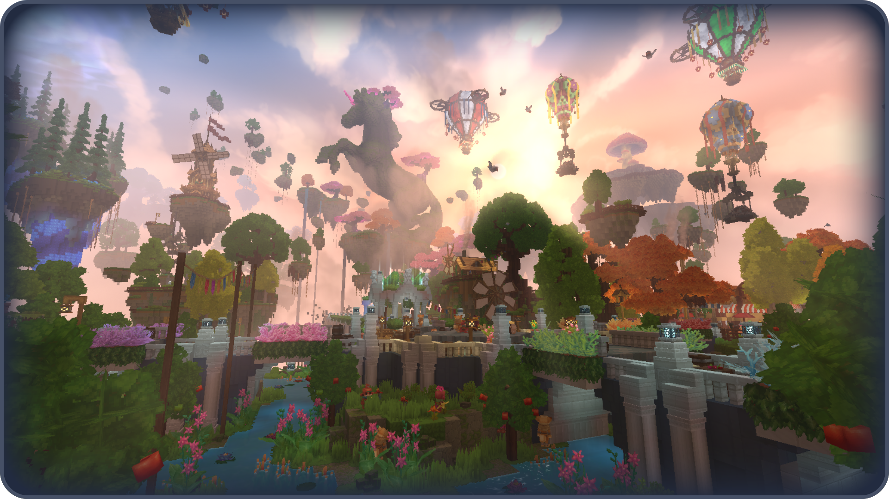
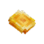
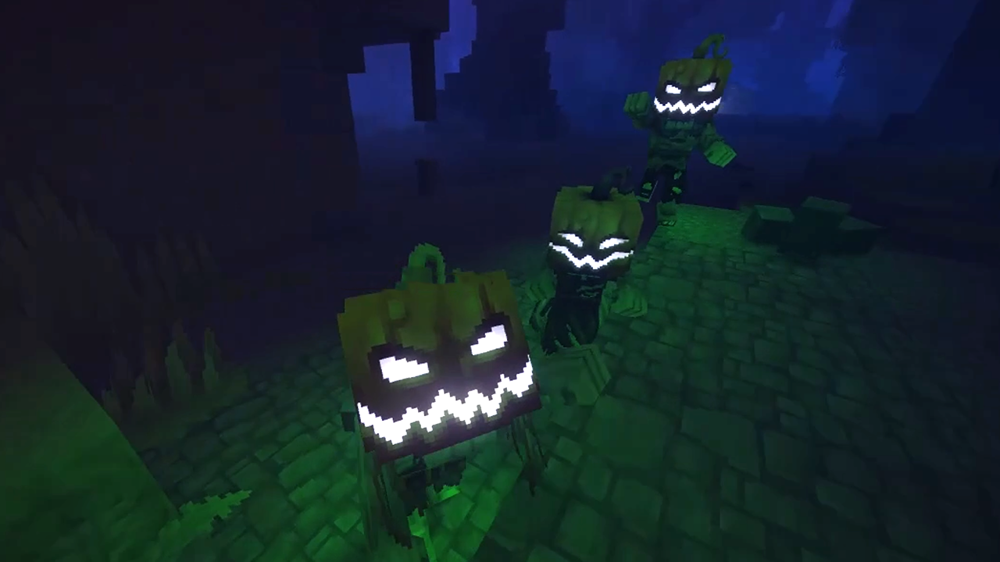
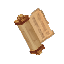
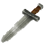
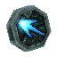
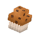

# Guide

Server custom content information. Some parts of the content shown here are under development and are subject change. Server content does not offer everything show here for now.

## Introduction

Server offers both vanilla experience (Adventure, Exploration) and custom content (Items, NPCs, Minigames, Events). Custom content goal is to offer extra mechanics and content into a balanced environment - it doesn't relay on adding end-game content or speed up vanilla progression. Server balance is designed for both new and experienced players.

## Basic content

* #### The Capital

A world that works as a lobby and meeting point, it contains most of the server custom content. [Coins](#item_coins) can be invested here for the players to obtain elements, decorations, weapons and more content. There are themed areas and local micro-events, this place grows as the server evolves adding new locations and content.

<i>[Click here](#the_capital_technical) to read The Capital technical information</i>
  

* #### Coins

The main item currency that can be earned from [Events](#gamemodes) and completing [Tasks](#tasks). These can be invested in [The Capital](#the_capital) stores and craft stations to get elements, items, resources and other custom content. Coins works as any other item, a huge stack amount is admited so best practice for players is to keep these inside their backpack.

* #### Gamemodes and Events

Themed content with unique mechanics (exploration, puzzles, PvP, dungeons). Some stays accessible anytime and others are available during a date period only (e.g. Halloween, Winter Holiday). Players can get access to these through specific locations at [The Capital](#the_capital) or crafting an 'Event Portal Key'.

<b>Open access to limited-time events:</b>

Some time-limited events are planned to be perpetual - these events will stay accessible if a player meets the requirements: e.g. a player who kept an 'Event Portal Key' will be able to access after the event end date.

  

  
<i>Click on the images to watch an event showcase video.</i>

## Advanced content

* #### Tasks

Objectives that players can complete to earn rewards from both generic activities or [Events](#gamemodes) related. Tasks works as items for now.

* #### World Events

Dynamic events occurring in different worlds to bring extra rewards and action to the players adventure. These events runs taking into count world and nearby players and they are completely optional.

* #### Weapons

Most of custom weapons brings unique status effects to make combat even more interesting without relying on Mana and Runes equipment (e.g. a modified sword with attached batteries can electrocute the enemy target). Weapons can be obtained at [The Capital](#the_capital) or as rewards from different sources.

Weapons are designed to bring players extra combat mechanics without the need to modify their custom builds but also being balanced for both server and vanilla content.

<b>Void-imbued weapons</b> (WIP)

Compatible weapons can be imbued in Void to boost original weapon damage and status effect. No durability loss upon death. A new Void-related status effect is added. Void-imbued weapons cannot be repaired, so players will require to craft a new one after the durability reaches zero.

* #### Runes and Abilities

(WIP)

* #### Food

Custom food and recipes to bring the player custom and unique status effects.

(WIP)

# Guide: technical

* #### The Capital

A huge aerial landscape cluster formed by different floating islands which contains huge structures, towns and open lands. Its purpose is to work as an all-in-one server spawn: it is not designed to be a hall between game modes and world instances but to offer a centralized place for the entire server where players can explore, exchange items, chill, chat or relax after an adventure. This world offers a space with different themed areas and districts which includes modes selection, activities, stores, minigames, roleplay spaces and much more.

<b>Aerial islands cluster</b>

Taking advantage of verticality for better navigation and POIs distribution, every place is handcrafted, detailed, modular and easy to modify / expand.

<b>Lore</b>

Extracted from their original worlds, these terrain fragments were conjoined at the center of the Skylands region. It is evolving by the purpose to serve as a multicultural union point and knowledge sharing center, creating a whole new land nicknamed as ‘The Capital’. This place is being built, adapted and shared by many creatures and civilization kinds who want to work all together, bringing a site to help the surface explorers and warriors.

<b>Gameplay philosophy</b>

Most areas of this place are free from player damage and movement speed has been increased a bit. The Capital allocates a secure environment for everyone, making it a non-hostile place. However, players can experience secondary game modes without leaving the Capital - a PvP mode is available at the ‘combat arena’ for example. Secondary modes are available for everyone who wants to access, these modes don't feature any scoring or timing systems. Freedom for everyone.

<b>Solving common wrong practices</b>

Floating texts and holograms distracts players, takes away the immersion and saturates the scenery. This place advocates for a better navigation design, from 3D space to interfaces. Players can reach specific places by moving around or selecting a destination at the server menu. Gamemodes are also accessible from both world places and menus.

Structures design avoids "forced brutalism" - extremely huge decorative buildings without purpose nor interiors. This world features plenty of unique decorative buildings for players to remember specific locations. The building's scale is not unnecessarily huge to make traveling easy and not tedious.

* #### Accessibility

Supported languages: English · Spanish

* #### Mods

Everything shown here have been made using Hytale in-game modding tools. No plugins. No third-party mods. A stable environment is primordial - the server does not rely on content outside the box, this way we have full control on updates over time, making custom changes needed and avoid possible future incompatibilities.

* <b>HR Creator HUB</b> (mother mod) This private modpack contains the majority of server custom content: Instances, WorldGen, NPCs, environments, items, effects and other essential content for the server to work. This mod also controls every custom modpack dependencies.

* <b>[HR Core Creator](https://www.curseforge.com/hytale/mods/hr-core-creator)</b>

* <b>[HR Windmills](https://www.curseforge.com/hytale/mods/hr-windmills)</b>
