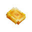
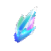
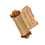
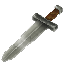
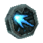

# Guide

Server custom content information.

## Introduction

Server offers both vanilla experience (Adventure, Exploration) and custom content (Items, NPCs, Minigames, Events). Custom content goal is to offer extra mechanics and content into a balanced environment - it doesn't relay on adding end-game content or speed up vanilla progression. Server balance is designed for both new and experienced players.

## Primordial content

* #### The Capital
A world that works as a lobby and meeting point, it contains most of the server custom content. [Coins](#item_coins) can be invested here for the players to obtain elements, decorations, weapons and more content. There are themed areas and local micro-events, this place grows as the server evolves adding new locations and content.

* #### Coins

The main item currency. These can be invested in [The Capital](#the_capital) stores and craft stations to get elements, items, resources and other custom content. Coins works as any other item, a huge stack amount is admited so best practice for the players is to keep these inside their backpack. Coins can be earned from [Events](#gamemodes) and completing [Tasks](#tasks).

* #### Gamemodes and Events

Themed content with unique mechanics (exploration, puzzles, PvP, dungeons). Some stays accessible anytime and others are available during a date period only (e.g. Halloween, Winter Holiday). Players can get access to these through specific locations at [The Capital](#the_capital) or crafting Portal Keys.

## Advanced content

* #### Tasks

Objectives that players can complete to earn rewards. Tasks can be both generic activities or [Events](#gamemodes) related.

* #### Weapons

Most of custom weapons brings unique status effects to make combat even more interesting without relying on Mana and Runes equipment (e.g. a modified sword with attached batteries can electrocute the enemy target). Weapons can be obtained at [The Capital](#the_capital) or as rewards from different sources.

Weapons are designed to bring players extra combat mechanics without the need to modify their custom builds but also being balanced for both server and vanilla content.

* Void-imbued weapons

(WIP) Compatible weapons can be imbued in Void to boost original weapon damage and status effect. No durability loss upon death. A new Void-related status effect is added. Void-imbued weapons cannot be repaired, so players will require to craft a new one after the durability reaches zero.

* #### Runes and Abilities
(WIP)

# Guide: technical

Supported languages: English, Spanish.

(WIP)
